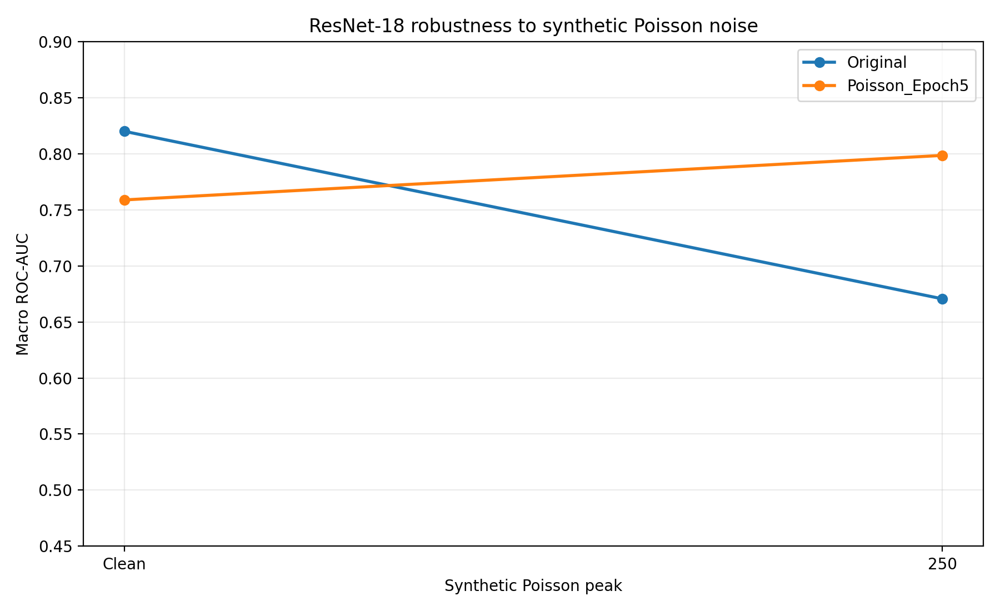

# Learning-Medical-Imaging

A personal computer vision project developed alongside [Stanford CS231n](https://cs231n.stanford.edu/), exploring deep learning for medical image analysis.

The current project investigates how synthetic Poisson noise affects chest X-ray pathology classification using ResNet-18, and whether noise-aware fine-tuning can recover classification performance as image quality deteriorates.

**Research motivation:** Investigate whether deep learning-based chest X-ray classification can remain effective at reduced radiation exposure.

**Important:** The current experiments use synthetic Poisson noise applied to processed chest radiographs. The noise parameter is not calibrated to radiation dose. These experiments therefore measure robustness to synthetic image degradation, not classification performance at verified reduced radiation doses.

## 1. Learning Resources

- [Stanford CS231n](https://cs231n.stanford.edu/)
- [Python and NumPy Tutorial](https://cs231n.github.io/python-numpy-tutorial/)
- [PyTorch Documentation](https://docs.pytorch.org/)

## 2. Desktop Setup

### Step 1: Install CUDA-enabled PyTorch

Install PyTorch 2.6.0 and torchvision 0.21.0 with CUDA 11.8 support:

```bash
python -m pip install torch==2.6.0 torchvision==0.21.0 --index-url https://download.pytorch.org/whl/cu118
```

### Step 2: Verify GPU access

Run the following code in a Python script or Jupyter Notebook:

```python
import torch
import torchvision

print("PyTorch:", torch.__version__)
print("Torchvision:", torchvision.__version__)
print("CUDA available:", torch.cuda.is_available())

if torch.cuda.is_available():
    print("GPU:", torch.cuda.get_device_name(0))
    print(
        "VRAM (GB):",
        round(
            torch.cuda.get_device_properties(0).total_memory / 1024**3,
            2,
        ),
    )
```

CUDA availability should be `True`.

**Development hardware:**

- GPU: NVIDIA RTX A2000 (12 GB VRAM)
- Operating system: Windows
- Python environment: Conda

## 3. Dataset

The project uses the NIH ChestXray14 dataset, accessed through the [chehablab/NIHChestXR](https://huggingface.co/datasets/chehablab/NIHChestXR) Hugging Face repository.

ChestXray14 contains frontal chest radiographs with 14 pathology labels. Because multiple pathologies can occur in the same image, the task is formulated as multi-label classification.

### Step 1: Download the dataset

Create the dataset directory relative to the project root:

```cmd
mkdir data\data
cd data\data
```

Download the six Parquet shards using Windows Command Prompt or Anaconda Prompt:

```cmd
curl.exe --ssl-revoke-best-effort -L -C - -o train-00000-of-00006.parquet "https://huggingface.co/datasets/chehablab/NIHChestXR/resolve/main/data/train-00000-of-00006.parquet"

curl.exe --ssl-revoke-best-effort -L -C - -o train-00001-of-00006.parquet "https://huggingface.co/datasets/chehablab/NIHChestXR/resolve/main/data/train-00001-of-00006.parquet"

curl.exe --ssl-revoke-best-effort -L -C - -o train-00002-of-00006.parquet "https://huggingface.co/datasets/chehablab/NIHChestXR/resolve/main/data/train-00002-of-00006.parquet"

curl.exe --ssl-revoke-best-effort -L -C - -o train-00003-of-00006.parquet "https://huggingface.co/datasets/chehablab/NIHChestXR/resolve/main/data/train-00003-of-00006.parquet"

curl.exe --ssl-revoke-best-effort -L -C - -o train-00004-of-00006.parquet "https://huggingface.co/datasets/chehablab/NIHChestXR/resolve/main/data/train-00004-of-00006.parquet"

curl.exe --ssl-revoke-best-effort -L -C - -o train-00005-of-00006.parquet "https://huggingface.co/datasets/chehablab/NIHChestXR/resolve/main/data/train-00005-of-00006.parquet"
```

Return to the project root before running training or evaluation scripts.

### Dataset splits

| Split | Images |
|---|---:|
| Training | ~90,256 |
| Validation | ~10,923 |
| Test | ~10,941 |

Metadata files contain the Parquet shard, row index, and pathology labels for each image.

Patient-level separation between splits should be verified before drawing research conclusions.

## 4. Classification Model

### Architecture

The baseline model uses ImageNet-pretrained ResNet-18, with its final fully connected layer replaced to predict 14 pathology labels.

```python
from torch import nn
from torchvision.models import resnet18, ResNet18_Weights

model = resnet18(
    weights=ResNet18_Weights.DEFAULT
)

model.fc = nn.Linear(
    model.fc.in_features,
    14
)
```

### Training configuration

| Parameter | Configuration |
|---|---|
| Architecture | ResNet-18 |
| Input | Grayscale chest X-ray repeated across 3 channels |
| Output | 14 pathology logits |
| Loss function | BCEWithLogitsLoss |
| Optimizer | Adam |
| Initial learning rate | 1e-4 |
| Noise fine-tuning learning rate | 1e-5 |
| Batch size | 32 |
| Baseline training | 3 epochs |
| Peak-250 fine-tuning | 2 additional epochs |

Input images are converted to tensors and normalized using ImageNet mean and standard deviation.

## 5. Synthetic Poisson Noise

To investigate robustness under image degradation, synthetic Poisson noise is introduced before ImageNet normalization.

For an input image normalized to the range [0, 1]:

$$
I_{\mathrm{noisy}} =
\frac{\operatorname{Poisson}(N I)}{N}
$$

where $N$ is the synthetic Poisson peak parameter.

Lower peak values produce stronger noise.

### Noise levels

| Peak | Qualitative interpretation |
|---|---|
| Clean | No synthetic noise |
| 10,000 | Very mild corruption |
| 5,000 | Mild corruption |
| 2,000 | Moderate corruption |
| 1,000 | Stronger corruption |
| 250 | Severe corruption |
| 25 | Extremely severe corruption |

These descriptions are qualitative and do not represent calibrated X-ray exposure fractions.

### Implementation

The noise transformation is implemented in `src/dataset.py`.

```python
class PoissonNoise:
    def __init__(self, peak=250):
        self.peak = peak

    def __call__(self, image):
        noisy = torch.poisson(
            image * self.peak
        ) / self.peak

        return noisy.clamp(0, 1)
```

## 6. Training Experiments

### Experiment 1: Clean baseline

Train ResNet-18 on clean chest X-rays.

**Checkpoint:**

`checkpoints/resnet18_adam_epoch_3.pth`

The baseline achieved a clean validation macro ROC-AUC of **0.8199**.

### Experiment 2: Fine-tuning at peak 250

Initialize from the clean-trained epoch-3 checkpoint and fine-tune using peak-250 synthetic Poisson noise.

**Checkpoints:**

- `checkpoints/resnet18_poisson250_epoch_4.pth`
- `checkpoints/resnet18_poisson250_epoch_5.pth`

### Experiment 3: Fine-tuning at peak 25

Initialize again from the clean-trained epoch-3 checkpoint and fine-tune directly using peak-25 synthetic Poisson noise.

**Checkpoint:**

`checkpoints/resnet18_poisson25_epoch_4.pth`

### Running training

From the project root:

```bash
python -m src.train_poisson
```

Before running, verify the input checkpoint, noise peak, and output checkpoint filenames in the training script.

## 7. Evaluation

The primary evaluation metric is macro ROC-AUC across the 14 pathology labels.

### Clean and peak-250 performance

| Model | Clean AUROC | Peak-250 AUROC | Peak-25 AUROC |
|---|---:|---:|---:|
| Clean-trained ResNet-18 | 0.8199 | 0.6733 | ~0.5335 |
| Peak-250 fine-tuned, epoch 4 | 0.7501 | 0.8000 | — |
| Peak-250 fine-tuned, epoch 5 | 0.7587 | 0.7991 | ~0.67 |
| Peak-25 fine-tuned, epoch 4 | 0.6489 | 0.6847 | 0.7637 |

Noise-aware fine-tuning substantially improves classification performance under peak-250 corruption, although performance on clean images decreases.


### Robustness to Synthetic Poisson Noise

To investigate how image degradation affects classification performance, ResNet-18 was evaluated across seven synthetic Poisson noise conditions.



**Key observations:**

1. The clean-trained model achieves the highest AUROC on clean images (0.8199), but performance decreases to 0.5263 at peak 25.

2. Fine-tuning at peak 250 improves performance under severe synthetic noise, reaching 0.7984 AUROC at peak 250 after 2 epochs.

3. Fine-tuning at peak 25 achieves 0.7637 AUROC at peak 25 after just 1 epoch, compared with 0.5263 for the clean-trained model.

4. Noise-specific fine-tuning introduces a trade-off: models perform better near their training noise level but generally perform worse on clean images.

**Interpretation:**

These experiments suggest that ResNet-18 can adapt to substantial synthetic image degradation. The deterioration observed when evaluating the clean-trained model on noisy images does not necessarily imply that all discriminative information has been lost.

However, the synthetic Poisson peak parameter is not calibrated to radiation exposure. These findings demonstrate robustness to simulated noise, not the feasibility of reducing clinical X-ray radiation dose.

**Reproducibility:**

Evaluation uses deterministic noise realizations to support consistent comparisons between model checkpoints.

Run:

```bash
python -m src.evaluate_poisson
```


## 8. Research Questions

The project investigates:

1. How does ResNet-18 classification performance deteriorate as synthetic noise increases?
2. Can noise-aware fine-tuning recover classification performance under severe image degradation?
3. How might these findings inform future research on reduced-exposure chest radiography?

## 9. Limitations

The current study uses processed chest radiographs rather than raw detector measurements.

Synthetic Poisson noise applied to processed image intensities does not fully reproduce reduced-exposure radiographic acquisition, including detector response, scatter, electronic noise, and vendor image processing.

The existing results therefore support conclusions about robustness to synthetic noise, not clinical feasibility at specific reduced radiation doses.

The experiments are intended for computer vision learning and exploratory research, not clinical decision-making.
