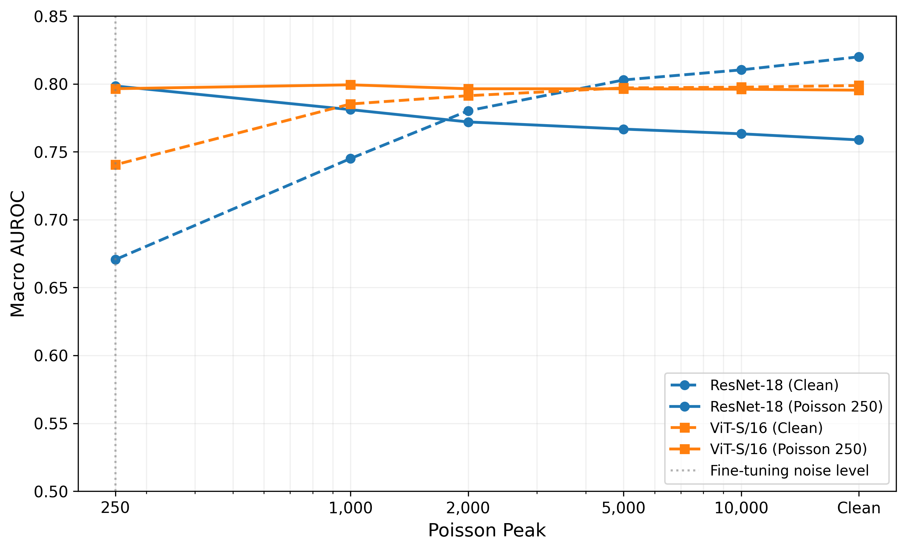

# Learning-Medical-Imaging

A personal medical-imaging deep-learning project developed alongside [Stanford CS231n](https://cs231n.stanford.edu/). I investigate how synthetic Poisson noise affects multi-label chest X-ray classification, and whether noise-aware fine-tuning improves robustness.

The project uses NIH ChestX-ray14 and compares two model architectures:

- **ResNet-18**, a convolutional neural network.
- **ViT-S/16**, a Vision Transformer initialized from ImageNet-pretrained weights.

Both models predict 14 thoracic findings. I evaluate them on clean images and several levels of synthetic Poisson noise, then examine the effect of fine-tuning on images corrupted at peak 250.

**Scope:** The noise is a synthetic image-degradation experiment. It is added to processed 8-bit radiographs and is not calibrated to radiation dose. The results do not establish performance at reduced X-ray exposure.

## Summary of findings

All numbers are macro ROC-AUC on the **validation** set, from single training runs.

| Model | Clean | Peak 250 | 
|---|---:|---:|
| ResNet-18, clean-trained (3 epochs) | 0.82 | 0.67 | 
| ResNet-18, fine-tuned at peak 250 (+2 epochs) | 0.76 | 0.80 | 
| ViT-S/16, clean-trained (5 epochs) | 0.80 | 0.74 |
| ViT-S/16, fine-tuned at peak 250 (3 clean + 2 noisy epochs) | 0.80 | 0.80 | 



1. **Both clean-trained models degrade as noise increases, and the ResNet degrades more.** From clean to peak 250, ResNet-18 loses about 0.15 AUC and ViT-S/16 about 0.06. The ResNet is better above roughly peak 2,000, and the ViT is better below it. 
2. **Fine-tuning at peak 250 recovers most of the loss at that level for both models** (both reach 0.80, close to the clean-trained ResNet's clean AUC of 0.82). 
3. **The clean-image cost of noise fine-tuning differs sharply.** ResNet-18 loses about 0.06 clean AUC. For ViT-S/16 the cost is negligible against an epoch-matched clean control. The fine-tuned ViT is also flat from clean to peak 250, whereas the fine-tuned ResNet improves as noise approaches its training level.
4. **More clean training made the ViT less noise-robust.** Going from 3 to 5 clean epochs raised its clean AUC by about 0.01 but lowered its peak-250 AUC by about 0.02.
5. **Effects are class-dependent.** For the clean-trained ResNet, findings defined by fine texture or thin structures (emphysema, pneumothorax, mass, pleural thickening, nodule) lost about 0.2-0.3 AUC at peak 250, versus about 0.08-0.13 for cardiomegaly, effusion, and edema. These classes also gained and paid the most from fine-tuning. ViT gains were more uniform. See results/Pathology-dependence.png.
6. **Pipeline sensitivity is large.** Retraining ResNet-18 with a different batch sampler lowered peak-250 AUC by about 0.06. Under that second pipeline, ResNet-34 matched ResNet-18 within about 0.01 at peak 250. Clean accuracy therefore does not reveal robustness, and a robustness gap needs to exceed roughly 0.06 at peak 250 before it can be told apart from pipeline variation. The ResNet curves above come from the original pipeline.

These are descriptive observations from the configurations tested. They do not show that one architecture is inherently more robust than the other.

## Limitations

- **Synthetic noise, not dose.** Poisson noise is added to processed 8-bit PNGs, not raw detector data, so detector response, scatter, electronic noise, vendor processing, and spatially correlated noise are not modeled, and the source images already contain noise. Peak values are relative simulation parameters. Relative to a 5,000-photon-peak reference (the convention used by Cohen et al. 2026), peaks 2,000, 1,000, and 250 correspond to photon reductions of 60%, 80%, and 95%. Related work using phantom-calibrated dose simulation found minimal CNN degradation at mild noise and low input resolution (Erenstein et al., *J. Imaging* 2025).
- **Validation set only.** No test-set results are reported, and checkpoints and noise levels were chosen using validation data.
- **Architecture is not isolated.** The two models differ in framework, resizing, normalization, optimizer, learning rate, and epoch budget. The ViT weights (`vit_small_patch16_224.augreg_in1k`) are ImageNet-1k, as are the ResNet's, but they come from a different training recipe (AugReg augmentation and regularization), which is known to affect robustness. Differences cannot be attributed to architecture alone.
- **Single runs.** No repeated seeds or confidence intervals. Pipeline variation alone moved ResNet-18's peak-250 AUC by about 0.06 (finding 6). 
- **Not for clinical use.** This is an exploratory learning project and was not validated for any clinical purpose.

## 1. Learning resources

- [Stanford CS231n](https://cs231n.stanford.edu/)
- [Python and NumPy tutorial](https://cs231n.github.io/python-numpy-tutorial/)
- [PyTorch documentation](https://docs.pytorch.org/)
- [timm documentation](https://huggingface.co/docs/timm/)

## 2. Desktop setup

The original development environment used PyTorch 2.6.0 and torchvision 0.21.0 with CUDA 11.8:

```bash
python -m pip install torch==2.6.0 torchvision==0.21.0 --index-url https://download.pytorch.org/whl/cu118
```

Additional dependencies include `timm`, `pandas`, `pyarrow`, `scikit-learn`, and `matplotlib`.

Development hardware:

- GPU: NVIDIA RTX A2000 (12 GB VRAM)
- Operating system: Windows
- Python environment: Conda

## 3. Dataset

The project uses NIH ChestX-ray14, accessed through the [chehablab/NIHChestXR](https://huggingface.co/datasets/chehablab/NIHChestXR) Hugging Face repository.

ChestX-ray14 contains frontal chest radiographs with 14 pathology labels. Since an image can contain more than one finding, the task is **multi-label classification**.

### Dataset splits

| Split | Images |
|---|---:|
| Training | ~90,256 |
| Validation | ~10,923 |
| Test | ~10,941 |

The splits were constructed at the patient level.

### Download the dataset

Create `data/data` relative to the project root and download the six Parquet shards from the Hugging Face dataset repository:

```cmd
mkdir data\data
cd data\data
```

The six files are named `train-00000-of-00006.parquet` through `train-00005-of-00006.parquet`.

Return to the project root before running notebooks or scripts.

## 4. Classification task and models

The models output 14 logits, one for each finding:

Atelectasis, Cardiomegaly, Effusion, Infiltration, Mass, Nodule, Pneumonia, Pneumothorax, Consolidation, Edema, Emphysema, Fibrosis, Pleural Thickening, and Hernia.

The loss function is `BCEWithLogitsLoss`. Performance is evaluated using per-pathology ROC-AUC and macro AUROC, calculated as the mean of the pathology-specific AUROCs.

### ResNet-18

The ResNet-18 classifier replaces the final fully connected layer with a 14-output linear layer.

The clean baseline was trained for three epochs. Noise-aware experiments initialized from the clean epoch-3 checkpoint and fine-tuned on synthetically corrupted images.

### ViT-S/16

The Transformer model is `vit_small_patch16_224.augreg_in1k` from [timm](https://huggingface.co/docs/timm/). Its classification head was replaced with a 14-output head.

Input radiographs were resized to 224 × 224 pixels. The ViT was initialized from ImageNet-pretrained weights and fine-tuned for the ChestX-ray14 multi-label task. The peak-250 noise-aware experiment started from a clean-trained checkpoint.

### Training configuration

| Setting | ResNet-18 | ViT-S/16 |
|---|---|---|
| Model source | torchvision | timm |
| Input | Grayscale repeated to 3 channels | Grayscale resized to 224 × 224, then repeated to 3 channels |
| Normalization | ImageNet mean and standard deviation | Mean 0.5, standard deviation 0.5 per channel |
| Output | 14 pathology logits | 14 pathology logits |
| Loss | BCEWithLogitsLoss | BCEWithLogitsLoss |
| Optimizer | Adam | AdamW |
| Batch size | 32 | 32 |
| Noise-aware fine-tuning | Peak 250 | Peak 250 |

The two model pipelines are not identical. In particular, image resizing, normalization, initialization, and optimization differ. The comparison is therefore exploratory.

## 5. Synthetic Poisson noise

Noise is applied to grayscale image tensors in the [0, 1] range, before channel repetition and model-specific normalization.

For an input image \(I\) and synthetic peak parameter \(N\):

\[
I_{\mathrm{noisy}} = \frac{\operatorname{Poisson}(N I)}{N}
\]

Lower peak values produce stronger synthetic noise.

| Peak | Qualitative description |
|---:|---|
| Clean | No synthetic noise |
| 10,000 | Very mild corruption |
| 5,000 | Mild corruption |
| 2,000 | Moderate corruption |
| 1,000 | Stronger corruption |
| 250 | Severe corruption; fine-tuning condition |

These descriptions are qualitative. The peak values are not calibrated to X-ray exposure or dose.

## 6. Experiments and evaluation

The evaluation compares clean-trained checkpoints with checkpoints fine-tuned using peak-250 images. Each checkpoint is evaluated on the same seven validation conditions: clean, 10,000, 5,000, 2,000, 1,000, 250, and 25.

The main questions are:

1. How does multi-label classification performance change as synthetic Poisson noise increases?
2. Does fine-tuning on noisy images improve performance at and around the noise level used for fine-tuning?
3. What is the associated trade-off in clean-image performance?
4. Do the observed trends differ between ResNet-18 and ViT-S/16?

### Main observations

- The clean-trained ResNet-18 has a clean validation macro AUROC of approximately **0.82**.
- At peak 250, both peak-250-fine-tuned models reach approximately **0.80** macro AUROC.
- The clean-image AUROC reduction after peak-250 fine-tuning is much smaller for ViT-S/16 than for ResNet-18 in the plotted experiment.

These are descriptive observations from the validation results and should be interpreted in light of the limitations above.

Potential extensions include self-supervised pretraining on unlabeled chest radiographs, label-efficiency experiments, and evaluation on an independent dataset. These are future directions, not results of the current project.
