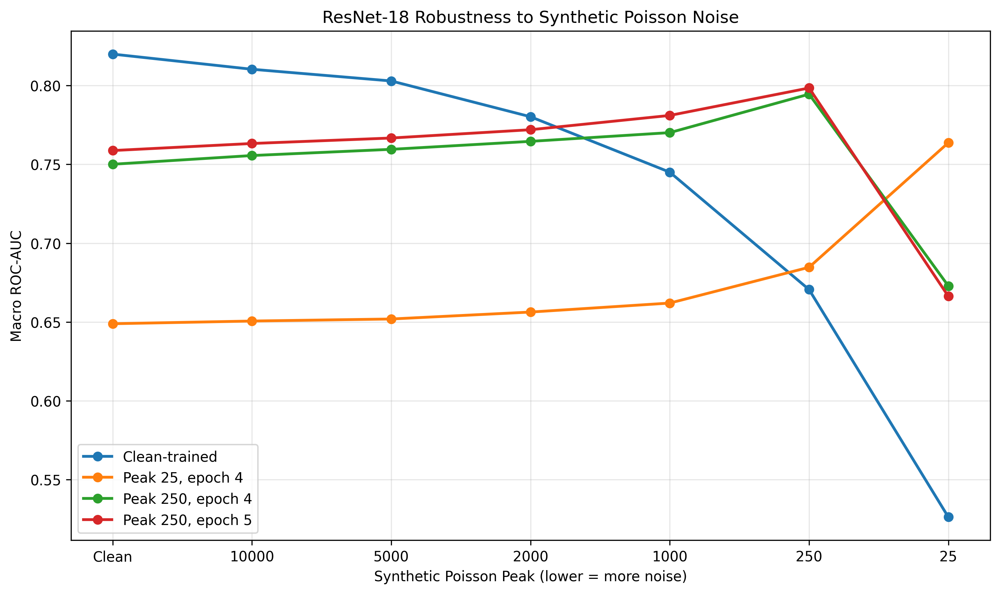

# Learning-Medical-Imaging

A personal project, built alongside Stanford CS231n, on how robust a chest X-ray classifier is to synthetic image noise, and whether brief noise-aware fine-tuning restores performance.

Using NIH ChestX-ray14 and an ImageNet-pretrained ResNet-18 (multi-label, 14 findings), I add synthetic Poisson noise at several strengths, measure how macro ROC-AUC degrades, and test whether fine-tuning on noisy images recovers it.

**Scope.** The noise is a synthetic stand-in for image-quality degradation. It is applied to processed 8-bit radiographs and is **not** calibrated to radiation dose, so this project makes no claims about reduced-dose imaging. Related work that simulates dose reduction with phantom-calibrated noise (Erenstein et al., *J. Imaging* 2025, 11(3), 90) found minimal CNN degradation at mild noise and low input resolution. My mildest noise levels are consistent with that, and my stronger levels go well beyond it.

## Summary of findings

1. **A clean-trained ResNet-18 is brittle to strong noise.** AUC falls gradually from 0.8199 and approaches chance (0.5263) at peak 25. Very mild noise (peak 10,000) changes little.
2. **Short noise-aware fine-tuning recovers most of the loss.** At peak 250, two epochs raise AUC from 0.6733 to 0.7991, within about 0.02 of the clean baseline. At peak 25, one epoch raises it from 0.5263 to 0.7637.
3. **Recovery costs clean-image accuracy, and the cost grows with training noise.** Clean AUC drops by about 0.06 after peak-250 fine-tuning and by about 0.17 after peak-25 fine-tuning. The curves cross between peak 2,000 and peak 1,000: above that, the clean-trained model is better.
4. **The fine-tuned models look specialized to their training noise.** The peak-250 model is nearly flat from clean to peak 1,000 and peaks at 250, and the peak-25 model scores only 0.6847 at peak 250, below the peak-250 model's 0.7991. This suggests, but does not prove, that fine-tuning at one noise level doesn't transfer to others. 



## Limitations

- **Synthetic noise, not dose.** Noise is added to processed 8-bit PNGs, not raw detector data. It ignores detector response, scatter, electronic noise, vendor post-processing, and spatially correlated noise, and the source images already contain their own noise. The "peak" values are only meaningful relative to each other, and the results should not be read as feasibility at any radiation dose.
- **Subgroups untested.** I have not analyzed performance by view position (PA/AP), sex, or age, or tested on an external dataset, so I can't say whether noise robustness matters more or less than other sources of distribution shift.
- **Not for clinical use.** This is an exploratory learning project and was not validated for any clinical purpose.

## 1. Learning Resources

- [Stanford CS231n](https://cs231n.stanford.edu/)
- [Python and NumPy Tutorial](https://cs231n.github.io/python-numpy-tutorial/)
- [PyTorch Documentation](https://docs.pytorch.org/)

## 2. Desktop Setup

### Step 1: Install CUDA-enabled PyTorch

Install PyTorch 2.6.0 and torchvision 0.21.0 with CUDA 11.8 support:

```bash
python -m pip install torch==2.6.0 torchvision==0.21.0 --index-url https://download.pytorch.org/whl/cu118
```

### Step 2: Verify GPU access

Run the following code in a Python script or Jupyter Notebook:

```python
import torch
import torchvision

print("PyTorch:", torch.__version__)
print("Torchvision:", torchvision.__version__)
print("CUDA available:", torch.cuda.is_available())

if torch.cuda.is_available():
    print("GPU:", torch.cuda.get_device_name(0))
    print(
        "VRAM (GB):",
        round(
            torch.cuda.get_device_properties(0).total_memory / 1024**3,
            2,
        ),
    )
```

CUDA availability should be `True`.

**Development hardware:**

- GPU: NVIDIA RTX A2000 (12 GB VRAM)
- Operating system: Windows
- Python environment: Conda

## 3. Dataset

The project uses the NIH ChestXray14 dataset, accessed through the [chehablab/NIHChestXR](https://huggingface.co/datasets/chehablab/NIHChestXR) Hugging Face repository.

ChestXray14 contains frontal chest radiographs with 14 pathology labels. Because multiple pathologies can occur in the same image, the task is formulated as multi-label classification.

### Step 1: Download the dataset

Create the dataset directory relative to the project root:

```cmd
mkdir data\data
cd data\data
```

Download the six Parquet shards using Windows Command Prompt or Anaconda Prompt:

```cmd
curl.exe --ssl-revoke-best-effort -L -C - -o train-00000-of-00006.parquet "https://huggingface.co/datasets/chehablab/NIHChestXR/resolve/main/data/train-00000-of-00006.parquet"

curl.exe --ssl-revoke-best-effort -L -C - -o train-00001-of-00006.parquet "https://huggingface.co/datasets/chehablab/NIHChestXR/resolve/main/data/train-00001-of-00006.parquet"

curl.exe --ssl-revoke-best-effort -L -C - -o train-00002-of-00006.parquet "https://huggingface.co/datasets/chehablab/NIHChestXR/resolve/main/data/train-00002-of-00006.parquet"

curl.exe --ssl-revoke-best-effort -L -C - -o train-00003-of-00006.parquet "https://huggingface.co/datasets/chehablab/NIHChestXR/resolve/main/data/train-00003-of-00006.parquet"

curl.exe --ssl-revoke-best-effort -L -C - -o train-00004-of-00006.parquet "https://huggingface.co/datasets/chehablab/NIHChestXR/resolve/main/data/train-00004-of-00006.parquet"

curl.exe --ssl-revoke-best-effort -L -C - -o train-00005-of-00006.parquet "https://huggingface.co/datasets/chehablab/NIHChestXR/resolve/main/data/train-00005-of-00006.parquet"
```

Return to the project root before running training or evaluation scripts.

### Dataset splits

| Split | Images |
|---|---:|
| Training | ~90,256 |
| Validation | ~10,923 |
| Test | ~10,941 |

Metadata files contain the Parquet shard, row index, and pathology labels for each image.

Patient-level separation between splits should be verified before drawing research conclusions.

## 4. Classification Model

### Architecture

The baseline model uses ImageNet-pretrained ResNet-18, with its final fully connected layer replaced to predict 14 pathology labels.

```python
from torch import nn
from torchvision.models import resnet18, ResNet18_Weights

model = resnet18(
    weights=ResNet18_Weights.DEFAULT
)

model.fc = nn.Linear(
    model.fc.in_features,
    14
)
```

### Training configuration

| Parameter | Configuration |
|---|---|
| Architecture | ResNet-18 |
| Input | Grayscale chest X-ray repeated across 3 channels |
| Output | 14 pathology logits |
| Loss function | BCEWithLogitsLoss |
| Optimizer | Adam |
| Initial learning rate | 1e-4 |
| Noise fine-tuning learning rate | 1e-5 |
| Batch size | 32 |
| Baseline training | 3 epochs |
| Peak-250 fine-tuning | 2 additional epochs |

Input images are converted to tensors and normalized using ImageNet mean and standard deviation.

## 5. Synthetic Poisson Noise

To investigate robustness under image degradation, synthetic Poisson noise is introduced before ImageNet normalization.

For an input image normalized to the range [0, 1]:

$$
I_{\mathrm{noisy}} =
\frac{\operatorname{Poisson}(N I)}{N}
$$

where $N$ is the synthetic Poisson peak parameter.

Lower peak values produce stronger noise.

### Noise levels

| Peak | Qualitative interpretation |
|---|---|
| Clean | No synthetic noise |
| 10,000 | Very mild corruption |
| 5,000 | Mild corruption |
| 2,000 | Moderate corruption |
| 1,000 | Stronger corruption |
| 250 | Severe corruption |
| 25 | Extremely severe corruption |

These descriptions are qualitative and do not represent calibrated X-ray exposure fractions.

### Implementation

The noise transformation is implemented in `src/dataset.py`.

```python
class PoissonNoise:
    def __init__(self, peak=250):
        self.peak = peak

    def __call__(self, image):
        noisy = torch.poisson(
            image * self.peak
        ) / self.peak

        return noisy.clamp(0, 1)
```

## 6. Training Experiments

### Experiment 1: Clean baseline

Train ResNet-18 on clean chest X-rays.

**Checkpoint:**

`checkpoints/resnet18_adam_epoch_3.pth`

The baseline achieved a clean validation macro ROC-AUC of **0.8199**.

### Experiment 2: Fine-tuning at peak 250

Initialize from the clean-trained epoch-3 checkpoint and fine-tune using peak-250 synthetic Poisson noise.

**Checkpoints:**

- `checkpoints/resnet18_poisson250_epoch_4.pth`
- `checkpoints/resnet18_poisson250_epoch_5.pth`

### Experiment 3: Fine-tuning at peak 25

Initialize again from the clean-trained epoch-3 checkpoint and fine-tune directly using peak-25 synthetic Poisson noise.

**Checkpoint:**

`checkpoints/resnet18_poisson25_epoch_4.pth`

### Running training

From the project root:

```bash
python -m src.train_poisson
```

Before running, verify the input checkpoint, noise peak, and output checkpoint filenames in the training script.


## 7. Research Questions

The project investigates:

1. How does ResNet-18 classification performance deteriorate as synthetic noise increases?
2. Can noise-aware fine-tuning recover classification performance under severe image degradation?
3. How might these findings inform future research on reduced-exposure chest radiography?
